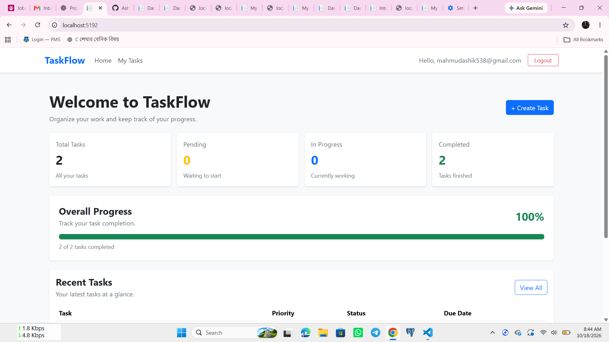

# TaskFlow — Task Management System

TaskFlow is a web-based task management application built with ASP.NET Core MVC. It helps users organize daily work, manage tasks, track progress, and monitor deadlines through a clean, modern dashboard.

## Features

- **User Authentication:** Register, log in, and log out using ASP.NET Core Identity.
- **Personal Task Management:** Manage personal tasks.
- **Task CRUD Operations:** Create, view, edit, and delete tasks.
- **Task Search:** Find tasks by title.
- **Status and Priority Filters:** Filter tasks based on status and priority.
- **Quick Status Updates:** Update task status directly from the task list.
- **Dashboard:** View total, pending, in-progress, and completed tasks.
- **Progress Tracking:** Monitor completion progress through a progress bar.
- **Priority Management:** Organize tasks by priority.
- **Due Date Tracking:** Set deadlines and monitor upcoming tasks.

## Technologies Used

- C#
- ASP.NET Core MVC
- .NET 10
- Entity Framework Core
- SQLite
- ASP.NET Core Identity
- HTML, CSS, and JavaScript
- Git and GitHub

## Getting Started

### Prerequisites

Install the following tools:

- [.NET 10 SDK](https://dotnet.microsoft.com/download/dotnet/10.0)
- [Visual Studio](https://visualstudio.microsoft.com/) or [Visual Studio Code](https://code.visualstudio.com/)
- [Git](https://git-scm.com/)

### Installation

1. Clone the repository:

   ```bash
   git clone https://github.com/Ashiqulislam171/TaskFlow.git
   ```

2. Navigate to the application project directory:

   ```bash
   cd TaskFlow/TaskFlow
   ```

3. Restore dependencies:

   ```bash
   dotnet restore
   ```

4. If the database migrations are available and have not yet been applied, update the database:

   ```bash
   dotnet ef database update
   ```

5. Build the application:

   ```bash
   dotnet build
   ```

6. Run the application:

   ```bash
   dotnet run
   ```

7. Open the local URL shown in the terminal.

> Note: If the `dotnet ef` command is unavailable, install or run the Entity Framework Core CLI tool as required by your environment.

## How to Use

1. Register an account.
2. Log in to access the application.
3. Create tasks with a title, description, status, priority, and optional due date.
4. Search for tasks or filter them by status and priority.
5. Update task statuses as work progresses.
6. Edit or delete tasks when needed.
7. Use the dashboard to monitor task progress.

## Database

TaskFlow uses SQLite for data storage and Entity Framework Core for database operations. ASP.NET Core Identity provides user authentication.

## Security

TaskFlow uses ASP.NET Core Identity for authentication. Task ownership and authorization should be verified against the application's implementation to ensure users can access only their own tasks.

## Future Improvements

- Task categories and tags
- Task sorting options
- Notifications for approaching deadlines
- Additional responsive UI improvements
- Unit and integration testing

## Application Screenshot

### Dashboard



## Author

**Ashiqul Islam**

GitHub: [Ashiqulislam171](https://github.com/Ashiqulislam171)

---

*TaskFlow — Organize your work. Track your progress. Get things done.*
